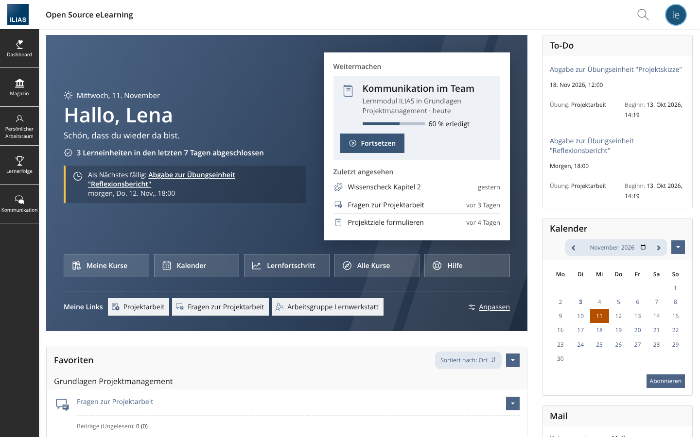
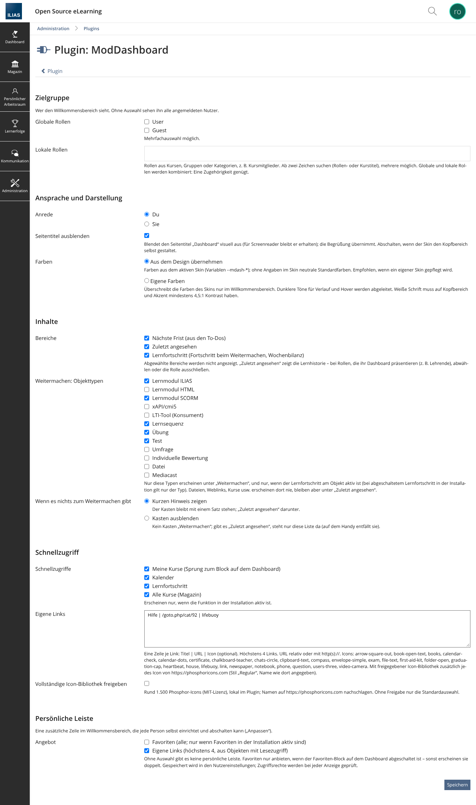

# ModDashboard – Willkommensbereich für das ILIAS-Dashboard

> **English:** ModDashboard is a UserInterfaceHook plugin for ILIAS 10 (branch `release_10`; ILIAS 11: branch `release_11`). It adds a personal welcome
> area on top of the dashboard: greeting, next deadline, “continue where you left off” with
> learning progress (restricted to chosen object types), recently viewed items, quick links and an
> optional personal bar with favourites and own links. German and English language files,
> no own database tables, licensed under GPL-3.0 like ILIAS itself.



<sub>Aufnahme aus ILIAS 11.5 (Darstellung unter ILIAS 10 gleich, siehe unten) mit dem Standard-Skin Delos und Demo-Daten. Handy-Ansicht: [docs/mobile.png](docs/mobile.png)</sub>

Flyer zum Weitergeben: [docs/ModDashboard-Flyer.pdf](docs/ModDashboard-Flyer.pdf)

UserInterfaceHook-Plugin für ILIAS 10. Setzt über die Dashboard-Inhalte einen
Willkommensbereich mit

- **Begrüßung** nach Tageszeit mit Vornamen und Datum, kurzer Einleitungssatz,
- **Wochenbilanz**: „3 Lerneinheiten in den letzten 7 Tagen abgeschlossen“ (nur wenn > 0),
- **Nächste Frist** aus den To-Dos (Übungen, Tests …), hervorgehoben unter 48 h,
- **Weitermachen**: zuerst angefangene Lernobjekte, mit Fortschritt und „zuletzt geöffnet“ –
  nur gewählte Objekttypen (Standard: Lernmodul, Lernsequenz, Übung, Test, SCORM) und nur mit
  aktivem Lernfortschritt; ohne Treffer ein kurzer Hinweis oder gar kein Kasten (einstellbar),
- **Zuletzt angesehen**: bis zu drei weitere Lernobjekte mit Zeitangabe,
- **Schnellzugriff**: Kalender, Lernfortschritt, Alle Kurse, optional Meine Kurse und
  bis zu vier eigene Links,
- **Persönliche Leiste** (optional): Favoriten und bis zu vier selbst gewählte Links; jede Person
  richtet sie über „Anpassen“ selbst ein oder schaltet sie ab.

Das Plugin legt keine Tabellen an. Gelesen werden nur Core-Daten: Navigationshistorie,
Lernfortschritt (`ut_lp_marks`), Lesezeitpunkte (`read_event`) und abgeleitete Aufgaben.
Einstellungen liegen in `settings` (Modul `moddash`) und werden bei der Deinstallation gelöscht.
Die persönliche Leiste speichert je Person einen Eintrag in den Nutzereinstellungen (`usr_pref`,
Schlüssel `moddash_personal`); auch er wird bei der Deinstallation gelöscht.

## Installation und Update

```bash
cd <ILIAS-Root>
git clone -b release_10 https://github.com/peterrtz/ModDashboard.git \
  public/Customizing/global/plugins/Services/UIComponent/UserInterfaceHook/ModDashboard
composer dump-autoload          # neue/umbenannte Klassen in die Classmap
php cli/setup.php build         # Plugin-Artefakt und ilCtrl-Struktur neu erzeugen
# PHP-FPM neu starten oder OPcache leeren
```

Danach in der Administration unter „Plugins“: ModDashboard **installieren/aktualisieren**
und **aktivieren**. Ein Update lädt auch die Sprachdateien neu.

**Für Deploy-Pipelines:** Die drei Schritte gehören in jedes Deployment, nicht nur ins
erste. Fehlen sie nach einem ILIAS-Update, ist das Plugin in der Liste nicht mehr zu sehen
oder die Konfiguration nicht erreichbar.

## ILIAS-Versionen

Dieser Branch ist für **ILIAS 10**. Je ILIAS-Version gibt es einen eigenen Branch:

| ILIAS | Branch | Status |
|---|---|---|
| 12 | [`release_12`](https://github.com/peterrtz/ModDashboard/tree/release_12) | **Alpha**, zum Testen |
| 11 | [`release_11`](https://github.com/peterrtz/ModDashboard/tree/release_11) | aktuell, neue Funktionen |
| 10 | [`release_10`](https://github.com/peterrtz/ModDashboard/tree/release_10) | Fehlerbehebungen |
| nächste | [`trunk`](https://github.com/peterrtz/ModDashboard/tree/trunk) | Entwicklung, nicht für den Betrieb |

Releases tragen die ILIAS-Version vorne: `v10.1.2.0` = Plugin 1.2.0 für ILIAS 10.

Unterschiede zu ILIAS 11: Lokale Rollen werden als Liste (höchstens 3000) mitgegeben und im Browser
gefiltert, eigene Farben als `#RRGGBB` eingetippt – das UI-Framework von ILIAS 10 hat weder Server-Suche
im Tag-Feld noch Farbwähler. Aufnahme unter ILIAS 10.12: [docs/ilias10.png](docs/ilias10.png)

## Konfiguration

Administration → Plugins → ModDashboard → Konfigurieren



| Einstellung | Wirkung |
|---|---|
| Anrede | Du oder Sie (deutsche Texte) |
| Anzeigen für (globale Rollen) | mehrere globale Rollen wählbar |
| Lokale Rollen | Rollen aus Kursen, Gruppen, Kategorien – per Suche mit Autovervollständigung (ab zwei Zeichen, Rollen- oder Kurstitel), mehrere möglich. Globale und lokale Rollen werden kombiniert: eine Zugehörigkeit genügt. Beide leer = alle |
| Farben | „Aus dem Design übernehmen“ (Standard: Skin-Variablen `--mdash-*` bzw. neutrale Werte) oder „Eigene Farben“ per Farbwähler für Kopfbereich, Akzent, Frist-Markierung und Hintergrund „Weitermachen“; dunklere Töne werden abgeleitet, zu geringer Kontrast (unter 4,5:1) wird beim Speichern abgelehnt |
| Seitentitel ausblenden | Standard an: Titel „Dashboard“ nur für Screenreader. Aus, wenn der Skin den Kopfbereich selbst gestaltet |
| Bereiche | Nächste Frist, Zuletzt angesehen, Lernfortschritt |
| Schnellzugriffe | Meine Kurse, Kalender, Lernfortschritt, Alle Kurse |
| Weitermachen: Objekttypen | Standard Lernmodul, Lernsequenz, Übung, Test, SCORM; wählbar sind Typen mit Lernfortschritt. Objekte erscheinen nur, wenn ihr Lernfortschritt aktiv ist (ist er in der ganzen Installation aus, zählt nur der Typ). Kein Ersatz durch Dateien, Weblinks oder Kurse |
| Wenn es nichts zum Weitermachen gibt | „Kurzen Hinweis zeigen“ (Standard) oder „Kasten ausblenden“; „Zuletzt angesehen“ bleibt in beiden Fällen |
| Eigene Links | je Zeile `Titel \| URL \| Icon`, höchstens 4 |
| Vollständige Icon-Bibliothek freigeben | Standard aus. An: alle rund 1.500 Phosphor-Icons (Stil „Regular“) für eigene Links, Namen wie auf [phosphoricons.com](https://phosphoricons.com) |
| Persönliche Leiste | Favoriten und/oder eigene Links (höchstens 4) anbieten; leer = keine Leiste. Jede Person entscheidet unter „Anpassen“ selbst |

Beispiel für eigene Links:

```
Stundenplan | https://stundenplan.example.de | calendar-check
Hilfe zur Lernplattform | /goto.php/crs/123 | lifebuoy
```

Zulässige Icons stehen im Formular; URLs müssen relativ sein oder mit `http(s)://` beginnen.

**Persönliche Leiste:** Über „Anpassen“ im Willkommensbereich schalten Nutzer Favoriten und eigene
Links ein oder aus und wählen bis zu vier Objekte aus ihren Kursen und Gruppen (samt Inhalt),
ihren Favoriten oder zuletzt besuchten Objekten. Beim Anzeigen prüft das Plugin jedes Mal das
Leserecht; gelöschte oder nicht mehr zugängliche Objekte verschwinden von selbst.
Die Auswahl ist auf 300 Einträge begrenzt, damit die Seite auch in großen Kursen schnell bleibt.

**Datenschutz:** „Zuletzt angesehen“ zeigt die persönliche Lernhistorie groß auf der
Startseite. Für Rollen, die ihr Dashboard im Unterricht zeigen, den Bereich abwählen
oder die Rolle unter „Anzeigen für“ ausschließen. Dasselbe gilt für die persönliche Leiste
(Favoriten); sie lässt sich zusätzlich von jeder Person selbst abschalten.

## Farben und Schrift

Standardwerte sind neutral (Delos-Blau). Ein Skin setzt eigene Werte auf `:root`, z. B. für ein grünes Erscheinungsbild:

```css
:root {
  --mdash-hero-1: #2E7D6B; --mdash-hero-2: #1F5C4F; --mdash-hero-3: #143D35;  /* Verlauf */
  --mdash-accent: #1F6F5E; --mdash-accent-dark: #1F5C4F;                    /* Buttons */
  --mdash-urgent: #F2C14E;   /* Kante bei Fristen < 48 h */
  --mdash-soft: #EDF5F2;     /* Hintergrund „Weitermachen“ */
  --mdash-track: #B9CFC8;    /* leerer Teil des Fortschrittsbalkens */
  --mdash-muted: #575757; --mdash-focus: #0078D7;
  --mdash-heading: Georgia, serif;
}
```

Die Standardwerte stehen in `:where(:root)` und verlieren deshalb immer gegen den Skin.
Alternativ ohne Skin-Änderung: In der Konfiguration „Eigene Farben“ wählen. Diese gelten nur im
Willkommensbereich und haben Vorrang vor dem Skin; Schrift und alles andere kommen weiter aus dem Skin.

SCSS-Variablen lassen sich nicht zur Laufzeit einstellen – ILIAS kompiliert sie nicht, sie stecken fest
im CSS des Skins. Das Plugin arbeitet deshalb mit CSS-Variablen.
Auf Weiß als Text-/Buttonfarbe mindestens 4,5:1 Kontrast einhalten.

## Icons

Mitgeliefert sind 35 [Phosphor Icons](https://phosphoricons.com) (Stil „regular“, MIT-Lizenz,
siehe [THIRD_PARTY.md](THIRD_PARTY.md)); 26 davon stehen als Standardauswahl für eigene Links bereit,
die übrigen nutzt das Plugin selbst. Sie liegen im Plugin und werden inline ausgeliefert –
der Browser lädt nichts von Phosphor oder einem CDN nach.

**Vollständige Bibliothek:** `icons-phosphor/` enthält alle 1.512 Phosphor-Icons im Stil „regular“
(rund 750 KB). Sie sind erst nutzbar, wenn in der Konfiguration „Vollständige Icon-Bibliothek
freigeben“ aktiv ist; das Formular verweist dann auf phosphoricons.com zum Nachschlagen der Namen.
Auch diese Icons kommen lokal aus dem Plugin. Wer sie nicht braucht, kann den Ordner löschen –
die Option verschwindet dann aus dem Formular.

**Eigene Icon-Bibliothek:** SVG-Dateien in `icons-custom/` ergänzen die Auswahl für eigene Links
oder ersetzen gleichnamige mitgelieferte Icons (z. B. `icons-custom/sun.svg`). Auch sie werden lokal
und bereinigt ausgeliefert; Details und Lizenzhinweise in [`icons-custom/README.md`](icons-custom/README.md).
Der Ordner bleibt bei `git pull` unangetastet, solange die Dateien nicht ins Repository übernommen werden.

## Aufbau

| Datei | Zweck |
|---|---|
| `classes/class.ilModDashboardUIHookGUI.php` | Hook auf `components/ILIAS/Dashboard/tpl.dashboard.html` (`template_get`, PREPEND) |
| `classes/class.ilModDashboardConfigGUI.php` | Konfigurationsformular (UI-Framework) |
| `classes/class.ilModDashboardPlugin.php` | Einstellungen, Link-Prüfung |
| `classes/class.ilModDashboardPersonalGUI.php` | Seite „Anpassen“ der persönlichen Leiste (über `ilUIPluginRouterGUI`) |
| `templates/tpl.home.html` | Markup |
| `css/moddashboard.css` | Gestaltung, Custom Properties `--mdash-*` |
| `lang/ilias_de.lang`, `lang/ilias_en.lang` | Texte, Sie-Fassungen mit Suffix `_formal` |
| `icons/*.svg` | Phosphor Icons (regular, MIT, siehe `icons/LICENSE-phosphor`) |
| `icons-phosphor/` | vollständige Phosphor-Bibliothek (regular, MIT), nur nach Freigabe nutzbar |
| `icons-custom/` | eigene Icons (optional), ergänzen oder ersetzen die mitgelieferten |

## Sicherheit

- Ausgaben laufen durch `htmlspecialchars`; Objekte nur mit Leserecht.
- Links aus der Navigationshistorie werden nur übernommen, wenn sie relativ sind oder
  auf den eigenen Host zeigen; sonst erzeugt das Plugin den Permalink selbst.
  `javascript:`, `data:` und protokoll-relative Adressen werden verworfen.
- Eigene Links: nur relativ oder http(s).
- Persönliche Leiste: Nutzer können nur Objekte aus der angebotenen Auswahl speichern; bei jeder
  Anzeige wird das Leserecht neu geprüft, Objekte im Papierkorb erscheinen nicht.
- Eigene Farben: nur Werte im Format `#RRGGBB` (geprüft), ausgegeben als CSS-Variablen am
  Willkommensbereich – keine freie CSS-Eingabe.
- Icons (auch eigene) werden vor dem Ausliefern bereinigt: keine Skripte, Event-Handler,
  Links oder externen Verweise; keine Verbindung zu Icon-Diensten.
- Fehler im Plugin werden geloggt; das Dashboard erscheint dann ohne Willkommensbereich.

## Hinweise

- Lernfortschritt wird nur gelesen, nicht neu berechnet (keine Last auf dem Dashboard).
  Veraltete Status („dirty“) erscheinen erst nach der nächsten regulären Neuberechnung.
- Der Seitentitel „Dashboard“ wird visuell ausgeblendet, bleibt für Screenreader erhalten.
- Nach ILIAS-Updates prüfen, ob `tpl.dashboard.html` noch so heißt – die einzige Stelle,
  an der das Plugin am Core-Markup hängt.
- Benötigt die PHP-Erweiterung `intl` für Datumsangaben in Langform; ohne sie gibt es eine Kurzform.

## Zusammenspiel mit der Dashboard-Administration

Getestet mit ILIAS 10.12 (Administration › Dashboard). Das Plugin folgt den Schaltern der Administration:

| Schalter in der Administration | Wirkung im Willkommensbereich |
|---|---|
| Ansicht „Meine Kurse und Gruppen“ aus | Schnellzugriff „Meine Kurse“ entfällt |
| Seitenleiste „Aufgaben“ aus | „Als Nächstes fällig“ entfällt |
| Lernfortschritt für Lernende aus (`lp_learner`) | Fortschrittsbalken, Wochenbilanz und Schnellzugriff „Lernfortschritt“ entfallen |
| Kalender global aus | Schnellzugriff „Kalender“ entfällt |
| Seitenleiste „Kalender“ aus | Schnellzugriff „Kalender“ bleibt – er führt zum Kalender selbst, nicht zum Seitenleisten-Block |
| Native „Dashboard-Seite“ (Anpassung) | Erscheint **über** dem Willkommensbereich (Core-Reihenfolge). Geeignet für kurze Hinweise; für längere Inhalte besser ausschalten |
| Darstellung Liste/Kacheln | Kein Einfluss; „Meine Kurse“ springt in beiden Fällen zum Block |

Es gibt keine Schalter, die doppelt wirken oder sich gegenseitig aufheben.
Die Frist erscheint bei aktiver Aufgaben-Seitenleiste doppelt (Willkommensbereich und To-Do-Block) – gewollt,
weil die Seitenleiste auf dem Handy erst weit unten kommt. Wird der Willkommensbereich
per Rollen ausgeblendet, zeigt ILIAS wieder den Seitentitel „Dashboard“.

## Update-Hinweise

- **Auf 1.3.0:** neue Klasse für die Seite „Anpassen“. Nach dem Einspielen `composer dump-autoload`
  und `php cli/setup.php build`, danach in der Plugin-Verwaltung „Aktualisieren“ und „Sprachen
  aktualisieren“. Ohne Build führt „Anpassen“ zu einer Fehlermeldung.

- ILIAS liest die Plugin-Version aus den Build-Artefakten. Eine neue Version erscheint in der
  Plugin-Verwaltung erst nach `php cli/setup.php build` – danach dort „Aktualisieren“.
  Zwischen Build und „Aktualisieren“ ist das Plugin **inaktiv** (Dashboard ohne Willkommensbereich) –
  beide Schritte direkt hintereinander ausführen oder `php cli/setup.php update` nutzen.
- ILIAS entfernt eigene Query-Parameter an CSS-Dateien und hängt nur `?_v=<ILIAS-Version>` an.
  Nach einem Plugin-Update ohne ILIAS-Update können Browser das alte `moddashboard.css` aus dem Cache nehmen.
  Abhilfe: Cache-Header des Webservers für `/Customizing/` kurz halten bzw. auf Revalidierung setzen.
- Das Plugin-CSS lädt vor dem Skin. Die Regel, die den Seitentitel ausblendet, ist deshalb bewusst
  etwas spezifischer. Gestaltet der Skin den Kopfbereich selbst, gibt es zwei Wege:
  „Seitentitel ausblenden“ in der Konfiguration abschalten (dann bleibt der Kopfbereich des Skins
  sichtbar), oder die Skin-Regeln auf `:not(:has(section.mdash--hide-title))` beschränken (dann
  greifen sie nur, wenn das Plugin den Titel nicht ausblendet).

## Lizenz

Copyright © 2026 Peter Reichartz. Lizenziert unter der
[GNU General Public License v3.0](LICENSE) (GPL-3.0-only) – wie ILIAS selbst.

Fremdbestandteile: siehe [THIRD_PARTY.md](THIRD_PARTY.md).
