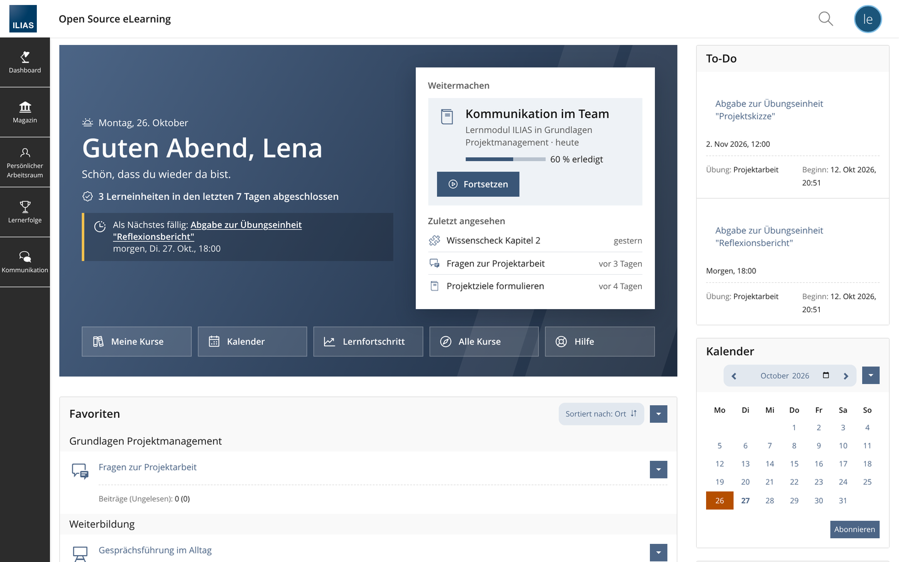
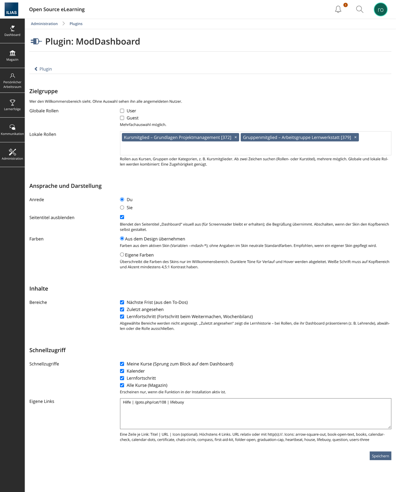

# ModDashboard – Willkommensbereich für das ILIAS-Dashboard

> **Alpha für ILIAS 12** – ILIAS 12 selbst ist noch nicht veröffentlicht (Stand: `trunk`,
> „12.0_alpha“). Dieser Branch ist zum Testen gedacht, nicht für den Betrieb. Für den Betrieb:
> `release_11` oder `release_10`.

> **English:** ModDashboard is a UserInterfaceHook plugin for ILIAS 12 – **alpha**, for testing only (stable: branch `release_11`; ILIAS 10: branch `release_10`). It adds a personal welcome
> area on top of the dashboard: greeting, next deadline, “continue where you left off” with
> learning progress, recently viewed items and quick links. German and English language files,
> no own database tables, licensed under GPL-3.0 like ILIAS itself.



<sub>Aufnahme aus ILIAS 11.5 mit dem Standard-Skin Delos und Demo-Daten. Handy-Ansicht: [docs/mobile.png](docs/mobile.png)</sub>

Flyer zum Weitergeben: [docs/ModDashboard-Flyer.pdf](docs/ModDashboard-Flyer.pdf)

UserInterfaceHook-Plugin für ILIAS 12 (Alpha). Setzt über die Dashboard-Inhalte einen
Willkommensbereich mit

- **Begrüßung** nach Tageszeit mit Vornamen und Datum, kurzer Einleitungssatz,
- **Wochenbilanz**: „3 Lerneinheiten in den letzten 7 Tagen abgeschlossen“ (nur wenn > 0),
- **Nächste Frist** aus den To-Dos (Übungen, Tests …), hervorgehoben unter 48 h,
- **Weitermachen**: zuerst angefangene Lernobjekte, mit Fortschritt und „zuletzt geöffnet“;
  Kurse und Gruppen nur, wenn es sonst nichts gibt (sie stehen ohnehin darunter),
- **Zuletzt angesehen**: bis zu drei weitere Lernobjekte mit Zeitangabe,
- **Schnellzugriff**: Kalender, Lernfortschritt, Alle Kurse, optional Meine Kurse und
  bis zu vier eigene Links.

Das Plugin legt keine Tabellen an. Gelesen werden nur Core-Daten: Navigationshistorie,
Lernfortschritt (`ut_lp_marks`), Lesezeitpunkte (`read_event`) und abgeleitete Aufgaben.
Einstellungen liegen in `settings` (Modul `moddash`) und werden bei der Deinstallation gelöscht.

## Installation und Update

```bash
cd <ILIAS-Root>
git clone -b release_12 https://github.com/peterrtz/ModDashboard.git \
  public/Customizing/global/plugins/Services/UIComponent/UserInterfaceHook/ModDashboard
composer dump-autoload          # neue/umbenannte Klassen in die Classmap
php cli/setup.php build         # Plugin-Artefakt und ilCtrl-Struktur neu erzeugen
# PHP-FPM neu starten oder OPcache leeren
```

Danach in der Administration unter „Plugins“: ModDashboard **installieren/aktualisieren**
und **aktivieren**. Ein Update lädt auch die Sprachdateien neu.

**Für Deploy-Pipelines:** Die drei Schritte gehören in jedes Deployment, nicht nur ins
erste. Fehlen sie nach einem ILIAS-Update, ist das Plugin in der Liste nicht mehr zu sehen
oder die Konfiguration nicht erreichbar.

## ILIAS-Versionen

Dieser Branch ist für **ILIAS 12 (Alpha)**. Je ILIAS-Version gibt es einen eigenen Branch:

| ILIAS | Branch | Status |
|---|---|---|
| 12 | [`release_12`](https://github.com/peterrtz/ModDashboard/tree/release_12) | **Alpha**, zum Testen |
| 11 | [`release_11`](https://github.com/peterrtz/ModDashboard/tree/release_11) | aktuell, neue Funktionen |
| 10 | [`release_10`](https://github.com/peterrtz/ModDashboard/tree/release_10) | Fehlerbehebungen |
| nächste | [`trunk`](https://github.com/peterrtz/ModDashboard/tree/trunk) | Entwicklung, nicht für den Betrieb |

Releases tragen die ILIAS-Version vorne: `v11.1.2.0` = Plugin 1.2.0 für ILIAS 11.
Vorabversionen haben ein Suffix: `v12.1.2.0-alpha.1`. In `plugin.php` steht weiter `1.2.0`,
weil ILIAS nur Ziffern auswertet.

### Stand ILIAS 12 (Alpha)

Geprüft auf ILIAS-`trunk` („12.0_alpha“, PHP 8.4) am 27.10.2026: Willkommensbereich,
Weitermachen mit Lernfortschritt, Frist, Wochenbilanz, Schnellzugriffe, Handy-Ansicht,
Konfiguration mit Rollensuche und Farbwählern, Rollenfilter. Am Plugin war keine Anpassung nötig.

Bekannte Punkte im ILIAS-Core (nicht im Plugin), Stand dieses Tests:

- `php cli/setup.php update` bricht beim Aktualisieren der **Plugin-Sprachdateien** ab
  („Identifier "logging.factory" is not defined“). Betrifft jedes Plugin. Umweg: Plugin in der
  Administration unter „Plugins“ installieren bzw. aktualisieren, dort „Sprachen aktualisieren“.
- Einige Lernfortschritts-Modi übergeben in `ilDBPdo::in()` einen String statt `false`
  (`ilLPStatusVisitedPages`, `ilLPStatusCollectionTLT`, `ilLPStatusCollectionMobs`) und brechen
  unter PHP 8.4 mit einem TypeError ab. Das trifft Lernmodule mit diesen Modi, nicht das Plugin.

Beides kann sich bis zum Release von ILIAS 12 ändern; das Plugin wird dann erneut geprüft.

## Konfiguration

Administration → Plugins → ModDashboard → Konfigurieren



| Einstellung | Wirkung |
|---|---|
| Anrede | Du oder Sie (deutsche Texte) |
| Anzeigen für (globale Rollen) | mehrere globale Rollen wählbar |
| Lokale Rollen | Rollen aus Kursen, Gruppen, Kategorien – per Suche mit Autovervollständigung (ab zwei Zeichen, Rollen- oder Kurstitel), mehrere möglich. Globale und lokale Rollen werden kombiniert: eine Zugehörigkeit genügt. Beide leer = alle |
| Farben | „Aus dem Design übernehmen“ (Standard: Skin-Variablen `--mdash-*` bzw. neutrale Werte) oder „Eigene Farben“ per Farbwähler für Kopfbereich, Akzent, Frist-Markierung und Hintergrund „Weitermachen“; dunklere Töne werden abgeleitet, zu geringer Kontrast (unter 4,5:1) wird beim Speichern abgelehnt |
| Seitentitel ausblenden | Standard an: Titel „Dashboard“ nur für Screenreader. Aus, wenn der Skin den Kopfbereich selbst gestaltet |
| Bereiche | Nächste Frist, Zuletzt angesehen, Lernfortschritt |
| Schnellzugriffe | Meine Kurse, Kalender, Lernfortschritt, Alle Kurse |
| Eigene Links | je Zeile `Titel \| URL \| Icon`, höchstens 4 |

Beispiel für eigene Links:

```
Stundenplan | https://stundenplan.example.de | calendar-check
Hilfe zur Lernplattform | /goto.php/crs/123 | lifebuoy
```

Zulässige Icons stehen im Formular; URLs müssen relativ sein oder mit `http(s)://` beginnen.

**Datenschutz:** „Zuletzt angesehen“ zeigt die persönliche Lernhistorie groß auf der
Startseite. Für Rollen, die ihr Dashboard im Unterricht zeigen, den Bereich abwählen
oder die Rolle unter „Anzeigen für“ ausschließen.

## Farben und Schrift

Standardwerte sind neutral (Delos-Blau). Ein Skin setzt eigene Werte auf `:root`, z. B. für ein grünes Erscheinungsbild:

```css
:root {
  --mdash-hero-1: #2E7D6B; --mdash-hero-2: #1F5C4F; --mdash-hero-3: #143D35;  /* Verlauf */
  --mdash-accent: #1F6F5E; --mdash-accent-dark: #1F5C4F;                    /* Buttons */
  --mdash-urgent: #F2C14E;   /* Kante bei Fristen < 48 h */
  --mdash-soft: #EDF5F2;     /* Hintergrund „Weitermachen“ */
  --mdash-track: #B9CFC8;    /* leerer Teil des Fortschrittsbalkens */
  --mdash-muted: #575757; --mdash-focus: #0078D7;
  --mdash-heading: Georgia, serif;
}
```

Die Standardwerte stehen in `:where(:root)` und verlieren deshalb immer gegen den Skin.
Alternativ ohne Skin-Änderung: In der Konfiguration „Eigene Farben“ wählen. Diese gelten nur im
Willkommensbereich und haben Vorrang vor dem Skin; Schrift und alles andere kommen weiter aus dem Skin.

SCSS-Variablen lassen sich nicht zur Laufzeit einstellen – ILIAS kompiliert sie nicht, sie stecken fest
im CSS des Skins. Das Plugin arbeitet deshalb mit CSS-Variablen.
Auf Weiß als Text-/Buttonfarbe mindestens 4,5:1 Kontrast einhalten.

## Icons

Mitgeliefert sind 24 [Phosphor Icons](https://phosphoricons.com) (Stil „regular“, MIT-Lizenz,
siehe [THIRD_PARTY.md](THIRD_PARTY.md)). Sie liegen im Plugin und werden inline ausgeliefert –
der Browser lädt nichts von Phosphor oder einem CDN nach.

**Eigene Icon-Bibliothek:** SVG-Dateien in `icons-custom/` ergänzen die Auswahl für eigene Links
oder ersetzen gleichnamige mitgelieferte Icons (z. B. `icons-custom/sun.svg`). Auch sie werden lokal
und bereinigt ausgeliefert; Details und Lizenzhinweise in [`icons-custom/README.md`](icons-custom/README.md).
Der Ordner bleibt bei `git pull` unangetastet, solange die Dateien nicht ins Repository übernommen werden.

## Aufbau

| Datei | Zweck |
|---|---|
| `classes/class.ilModDashboardUIHookGUI.php` | Hook auf `components/ILIAS/Dashboard/tpl.dashboard.html` (`template_get`, PREPEND) |
| `classes/class.ilModDashboardConfigGUI.php` | Konfigurationsformular (UI-Framework) |
| `classes/class.ilModDashboardPlugin.php` | Einstellungen, Link-Prüfung |
| `templates/tpl.home.html` | Markup |
| `css/moddashboard.css` | Gestaltung, Custom Properties `--mdash-*` |
| `lang/ilias_de.lang`, `lang/ilias_en.lang` | Texte, Sie-Fassungen mit Suffix `_formal` |
| `icons/*.svg` | Phosphor Icons (regular, MIT, siehe `icons/LICENSE-phosphor`) |
| `icons-custom/` | eigene Icons (optional), ergänzen oder ersetzen die mitgelieferten |

## Sicherheit

- Ausgaben laufen durch `htmlspecialchars`; Objekte nur mit Leserecht.
- Links aus der Navigationshistorie werden nur übernommen, wenn sie relativ sind oder
  auf den eigenen Host zeigen; sonst erzeugt das Plugin den Permalink selbst.
  `javascript:`, `data:` und protokoll-relative Adressen werden verworfen.
- Eigene Links: nur relativ oder http(s).
- Eigene Farben: nur Werte im Format `#RRGGBB` (geprüft), ausgegeben als CSS-Variablen am
  Willkommensbereich – keine freie CSS-Eingabe.
- Icons (auch eigene) werden vor dem Ausliefern bereinigt: keine Skripte, Event-Handler,
  Links oder externen Verweise; keine Verbindung zu Icon-Diensten.
- Fehler im Plugin werden geloggt; das Dashboard erscheint dann ohne Willkommensbereich.

## Hinweise

- Lernfortschritt wird nur gelesen, nicht neu berechnet (keine Last auf dem Dashboard).
  Veraltete Status („dirty“) erscheinen erst nach der nächsten regulären Neuberechnung.
- Der Seitentitel „Dashboard“ wird visuell ausgeblendet, bleibt für Screenreader erhalten.
- Nach ILIAS-Updates prüfen, ob `tpl.dashboard.html` noch so heißt – die einzige Stelle,
  an der das Plugin am Core-Markup hängt.
- Benötigt die PHP-Erweiterung `intl` für Datumsangaben in Langform; ohne sie gibt es eine Kurzform.

## Zusammenspiel mit der Dashboard-Administration

Getestet mit ILIAS 11.5 (Administration › Dashboard). Das Plugin folgt den Schaltern der Administration:

| Schalter in der Administration | Wirkung im Willkommensbereich |
|---|---|
| Ansicht „Meine Kurse und Gruppen“ aus | Schnellzugriff „Meine Kurse“ entfällt |
| Seitenleiste „Aufgaben“ aus | „Als Nächstes fällig“ entfällt |
| Lernfortschritt für Lernende aus (`lp_learner`) | Fortschrittsbalken, Wochenbilanz und Schnellzugriff „Lernfortschritt“ entfallen |
| Kalender global aus | Schnellzugriff „Kalender“ entfällt |
| Seitenleiste „Kalender“ aus | Schnellzugriff „Kalender“ bleibt – er führt zum Kalender selbst, nicht zum Seitenleisten-Block |
| Native „Dashboard-Seite“ (Anpassung) | Erscheint **über** dem Willkommensbereich (Core-Reihenfolge). Geeignet für kurze Hinweise; für längere Inhalte besser ausschalten |
| Darstellung Liste/Kacheln | Kein Einfluss; „Meine Kurse“ springt in beiden Fällen zum Block |

Es gibt keine Schalter, die doppelt wirken oder sich gegenseitig aufheben.
Die Frist erscheint bei aktiver Aufgaben-Seitenleiste doppelt (Willkommensbereich und To-Do-Block) – gewollt,
weil die Seitenleiste auf dem Handy erst weit unten kommt. Wird der Willkommensbereich
per Rollen ausgeblendet, zeigt ILIAS wieder den Seitentitel „Dashboard“.

## Update-Hinweise

- ILIAS liest die Plugin-Version aus den Build-Artefakten. Eine neue Version erscheint in der
  Plugin-Verwaltung erst nach `php cli/setup.php build` – danach dort „Aktualisieren“.
  Zwischen Build und „Aktualisieren“ ist das Plugin **inaktiv** (Dashboard ohne Willkommensbereich) –
  beide Schritte direkt hintereinander ausführen oder `php cli/setup.php update` nutzen.
- ILIAS entfernt eigene Query-Parameter an CSS-Dateien und hängt nur `?_v=<ILIAS-Version>` an.
  Nach einem Plugin-Update ohne ILIAS-Update können Browser das alte `moddashboard.css` aus dem Cache nehmen.
  Abhilfe: Cache-Header des Webservers für `/Customizing/` kurz halten bzw. auf Revalidierung setzen.
- Das Plugin-CSS lädt vor dem Skin. Die Regel, die den Seitentitel ausblendet, ist deshalb bewusst
  etwas spezifischer. Gestaltet der Skin den Kopfbereich selbst, gibt es zwei Wege:
  „Seitentitel ausblenden“ in der Konfiguration abschalten (dann bleibt der Kopfbereich des Skins
  sichtbar), oder die Skin-Regeln auf `:not(:has(section.mdash--hide-title))` beschränken (dann
  greifen sie nur, wenn das Plugin den Titel nicht ausblendet).

## Lizenz

Copyright © 2026 Peter Reichartz. Lizenziert unter der
[GNU General Public License v3.0](LICENSE) (GPL-3.0-only) – wie ILIAS selbst.

Fremdbestandteile: siehe [THIRD_PARTY.md](THIRD_PARTY.md).
